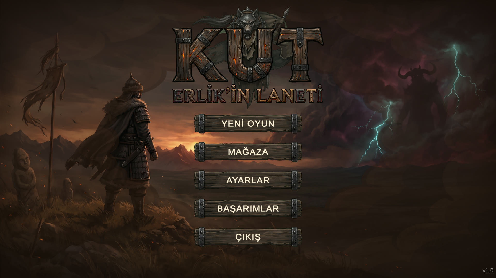
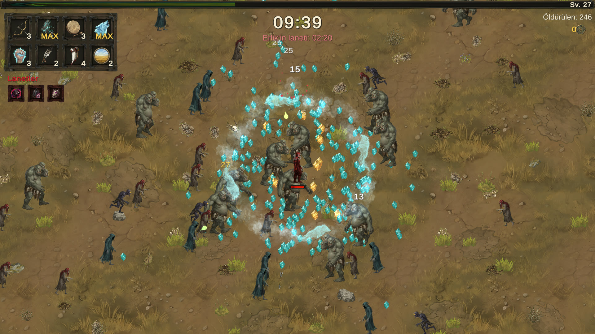
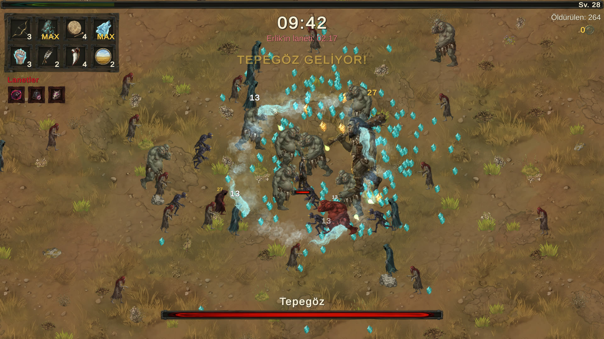
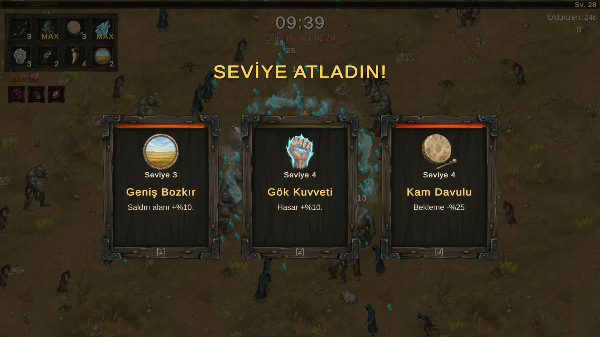

# KUT: Erlik'in Laneti

Türk mitolojisinden beslenen, karanlık ve elle boyanmış görünümlü 2D bir **hayatta kalma (survivors-like)** oyunu.
Bozkırda Alp olarak dalga dalga gelen Albastılara, Abasılara ve Yelbegenlere karşı 20 dakika dayan, bölüm canavarını yen.
Her 3 dakikada bir Erlik Han seni lanetler: üç lanetten birini seçmek zorundasın ve lanetler kalıcıdır.

## İndir ve oyna

1. **[Son sürümü indir (Windows, ~120 MB)](https://github.com/mhangundog/kut-erlikin-laneti/releases/latest)**: `KUT_Erlikin_Laneti_v1.0_Windows.zip`
2. Zip'i istediğin bir klasöre çıkar. Kurulum gerekmez, oyun taşınabilir.
3. `KUT.exe` dosyasını çalıştır.

> Windows "bilinmeyen yayımcı" uyarısı verirse **Ek bilgi → Yine de çalıştır**'a tıkla (oyun dijital olarak imzalı değil).

**Sistem:** Windows 10/11 (64 bit), DirectX 11/12 destekli ekran kartı, ~350 MB boş alan.

## Ekran görüntüleri

| | |
|---|---|
|  |  |
|  |  |

## Özellikler

- **Erlik'in Lanetleri:** her 3 dakikada zorunlu lanet seçimi. 17 lanet var, 6'sı oyunun kurallarını değiştirir (durursan hasar alırsın, ölümsüz bir gölge seni kovalar, ölen düşman kor bırakır, rüzgâr seni sürükler...).
- **9 silah, 9 evrim:** Ok ve Yay, Alp Kılıcı, Bozkurt Ruhu, Kam Davulu, Kopuz, Alaz Çemberi, Yada Taşı, Kargı, Balbal. Silah 5. seviyeye, eşi olan pasif 3. seviyeye ulaşınca silah kendiliğinden evrilir (ör. Tengri'nin Okları, Asena'nın Sürüsü, Dede Korkut'un Kopuzu).
- **10 pasif yetenek**, 4 silah + 4 pasif yuvası (mağazadan 6 + 6'ya kadar açılır).
- **2 karakter** (Alp, Kam), **2 harita** (Bozkır, Erlik'in Yeraltı Diyarı), **2 bölüm canavarı** (Tepegöz, Erlik Han).
- **Kalıcı ilerleme:** turlarda kazanılan Yarmak sikkesiyle 11 yükseltmeli mağaza, 9 başarım, evrim koleksiyonu.
- **Tur kaydı:** oyunu kapatsan da tur kaldığı yerden devam eder.
- **Klavye ve gamepad** desteği, tuş atama, ayarlar, öğretici.
- Arayüz koyu oyma ahşap ve dövme demir; karakterler videodan çıkarılmış kare kare yürüme animasyonu.

## Kontroller

| Eylem | Klavye | Gamepad |
|---|---|---|
| Hareket | WASD / ok tuşları | Sol çubuk |
| Kart seçimi | 1 - 2 - 3 | X - Y - B |
| Duraklat | Esc | Start |
| Menüde gezinme | Fare / ok tuşları | Yön tuşları, A seç, B geri |

Tüm tuşlar oyun içinden (Ayarlar → Tuşlar) değiştirilebilir. Oyun Türkçedir.

## Teknik

- **Motor:** Unity 6 (6000.3), C#
- Veri odaklı yapı: silahlar, pasifler, lanetler, düşmanlar ve mağaza ScriptableObject dosyaları; tüm arayüz ve efektler sahne/prefab olarak düzenlenebilir.
- Nesne havuzu, Input System (klavye + gamepad), Animator tabanlı arayüz animasyonları, JSON tur kaydı.

## Emeği geçenler

- **Tasarım ve geliştirme:** [mhangundog](https://github.com/mhangundog)
- **Görseller:** yapay zekâ destekli üretim (Google Gemini, Google Flow), oyun için düzenlendi.
- **Sesler ve müzik (Unity Asset Store, ücretsiz paketler):**
  - "RPG Medieval Times" — LUTUMPLAY (müzik)
  - "Middle Age - Medieval Action Sound FX Pack" — mariobastos
  - "FREE Casual Game SFX Pack" — Dustyroom
  - "Thunder Sound Set Volume 1" — Thunder Pop Productions

---

*English:* **KUT: Curse of Erlik** is a dark, hand-painted 2D survivors-like game inspired by Turkic mythology, made with Unity 6 and C#.
Survive 20 minutes on the steppe, evolve 9 weapons and pick one of Erlik Khan's permanent curses every 3 minutes.
Download the Windows build from [Releases](https://github.com/mhangundog/kut-erlikin-laneti/releases/latest), unzip and run `KUT.exe` (no install needed). The game is in Turkish.
